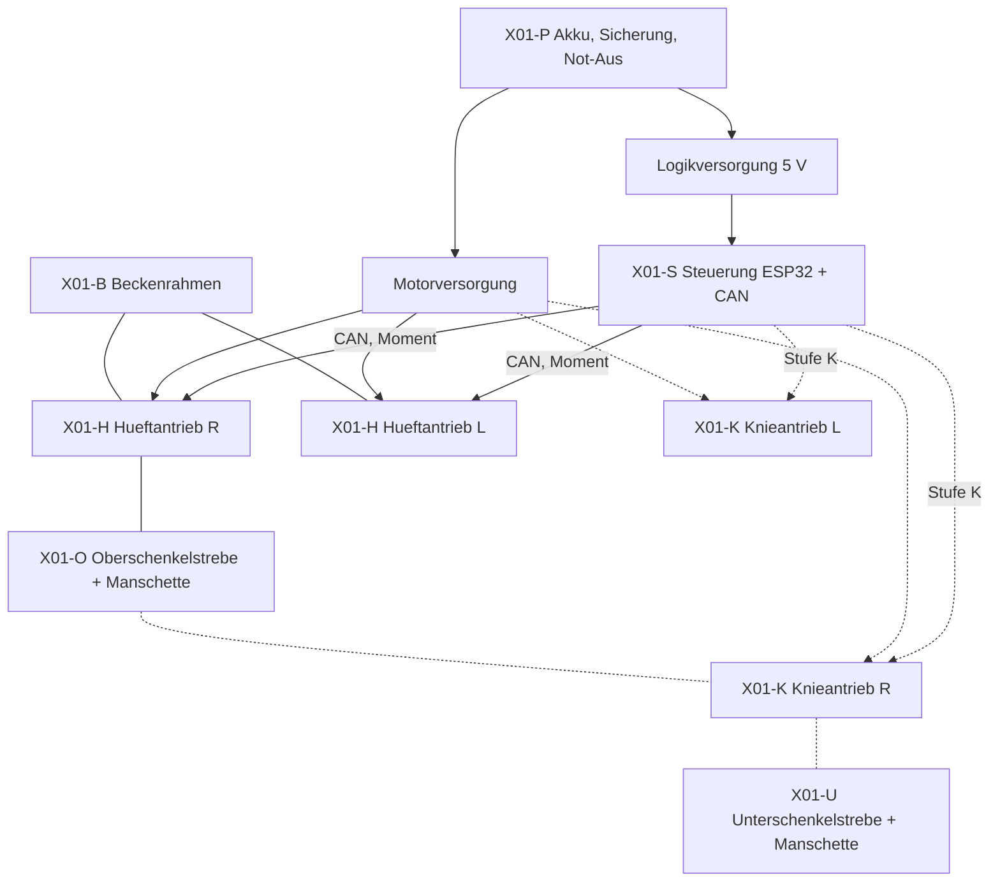

# Eigenbau-Beinantrieb X01: aktive Hueft- und Knieunterstuetzung

**Status 2026-11-23: Entwicklungsentwurf.** Es gibt kein gebautes Geraet, keine
Messung und keinen Tragetest. Vorhanden sind dieses Konzept, die Steuerlogik
(`Code/ExoControl/LegAssist/`) und ihre Tests auf dem Entwicklungsrechner.
Ein bestandener Softwaretest ist keine Hardwareabnahme.

Ein motorisiertes Gestell am Koerper kann verletzen: Es bringt Drehmoment
direkt auf Huefte und Knie. Dieser Guide beschreibt deshalb zuerst, was
nachgewiesen sein muss, und erst danach, wie die Unterstuetzung arbeitet.
Wer keine Erfahrung mit Antriebstechnik und Akkus dieser Leistungsklasse hat,
baut den Pruefstand (Abschnitt 9, P1 und P2) und nicht das tragbare Geraet.

## 1. Vorbild und Abgrenzung

Vorbild ist das Hypershell Halo, ein Seriengeraet mit vier Motoren an beiden
Hueften und Knien. Angaben der Herstellerseite, abgerufen am 2026-11-23:

| Angabe | Wert laut Hersteller |
| --- | --- |
| Motoren | 4, an Hueften und Knien |
| Spitzenleistung | 1490 W; die Seite nennt den Wert einmal fuer das System und einmal je Kniemotor |
| Masse | 2,6 kg ohne Tragesystem, 3,2 kg mit Tragesystem, jeweils ohne Akku |
| Akku | 72 Wh |
| Reichweite | 20 km, gemessen auf dem Laufband bei 4 km/h, 1 Grad Steigung, Eco-Modus mit 30 % Leistung |
| Schutzart | IP54 unter Laborbedingungen |
| Drehmoment je Gelenk | nicht angegeben |
| Einschraenkung | Kein Medizinprodukt; Nutzer muessen ohne Hilfe gehen, die Beine heben und das Gleichgewicht halten koennen |

Quelle: [Hypershell Halo, Herstellerseite](https://ca.hypershell.tech/pages/hypershell-halo-exoskeleton).
Presseberichte nennen 2299 USD als Preis; auf der abgerufenen Herstellerseite
stand kein Preis.

X01 uebernimmt davon nur das Prinzip: Antriebe seitlich an Huefte und Knie,
die beim Gehen ein kleines Moment in Bewegungsrichtung geben. X01 ist
ausdruecklich **nicht**:

- ein Traggestell fuer die Ruestung. Das Gewicht bleibt am Koerper; der
  [Bodenrahmen](Exoskelett.md#3a-neues-entwicklungsziel-ruestungslast-zum-boden)
  ist ein anderes Entwicklungsziel.
- eine Balance- oder Sturzsicherung. Faellt der Antrieb aus, muss die Person
  mit Ruestung und stromlosem Gestell sicher stehen und gehen koennen.
- ein Medizinprodukt oder eine Gehhilfe.
- eine Kopie des Halo. Masse, Reichweite und Wirkung des Seriengeraets lassen
  sich aus diesem Entwurf nicht ableiten.

## 2. Aufbau

| ID | Baugruppe | Aufgabe | Stand |
| --- | --- | --- | --- |
| X01-B | Beckenrahmen | Steifer Bogen ueber Ruecken und Beckenkamm, traegt beide Hueftantriebe und stuetzt deren Gegenmoment am Becken ab | Konzept, kein CAD |
| X01-H | Hueftmodul L/R | Antrieb auf der Beuge-/Streckachse der Huefte, darueber ein freies Gelenk fuer das Abspreizen | Konzept, kein CAD |
| X01-O | Oberschenkelstrebe | Laengenverstellbare Strebe mit gepolsterter Manschette oberhalb des Knies | Konzept, kein CAD |
| X01-K | Kniemodul L/R | Zweiter Antrieb auf der Knieachse (nur Stufe K) | Konzept, kein CAD |
| X01-U | Unterschenkelstrebe | Strebe und Manschette unterhalb des Knies (nur Stufe K) | Konzept, kein CAD |
| X01-S | Steuerung | ESP32, CAN-Transceiver, Taster, Status-LED | Sketch und Host-Tests vorhanden |
| X01-P | Energie | Akku mit BMS, Sicherung, Not-Aus in der Motorleitung | Konzept, nicht ausgelegt |

Gebaut wird in zwei Stufen. **Stufe H** hat nur die beiden Hueftantriebe.
**Stufe K** ergaenzt die Knie und entspricht erst damit dem Vorbild. Stufe K
beginnt erst, wenn Stufe H die Nachweisfolge bestanden hat: Ein Knieantrieb
sitzt an einem Gelenk, dessen Drehachse beim Beugen wandert, und stuetzt das
Standbein. Fehler dort wirken direkt auf das Knie.

## 3. Antriebe

Geeignet sind Antriebe mit niedriger Uebersetzung, die sich von aussen
leicht durchdrehen lassen. Dann bedeutet "Moment null" freies Mitlaufen, und
eine Abschaltung blockiert das Bein nicht. Hoch uebersetzte Servos oder
Schneckengetriebe scheiden deshalb aus.

Als Referenz dient die CubeMars-AK-Serie, weil das offene Forschungsprojekt
[OpenExo](https://theopenexo.nau.edu/) (Northern Arizona University,
[Science Robotics 2025](https://doi.org/10.1126/scirobotics.adt1591)) sie in
Hueft- und Sprunggelenkantrieben einsetzt und Bauunterlagen veroeffentlicht.
OpenExo ist die wichtigste Vorlage fuer Mechanik und Elektronik dieses
Entwurfs; vor eigenem CAD dort die Hueftmodule ansehen.

| Antrieb | Nennspannung | Nennmoment | Spitzenmoment | Masse | Uebersetzung |
| --- | --- | --- | --- | --- | --- |
| AK60-6 V3.0 KV80 | 24/48 V | 3 Nm | 9 Nm | 380 g | 6:1 |
| AK80-9 V3.0 KV100 | 48 V | 9 Nm | 22 Nm | 490 g | 9:1 |
| AK70-10 KV100 | 24/48 V | 8,3 Nm | 24,8 Nm | 621 g | 10:1 |

Quelle: [CubeMars, Produktseite AK80-9 V3.0 mit Vergleichstabelle](https://www.cubemars.com/product/ak80-9-kv100-robotic-actuator.html),
abgerufen am 2026-11-23. Aeltere AK80-9 (ohne V3.0) sind mit 18 Nm Spitze und
485 g gelistet. Werte vor dem Kauf am Datenblatt der bestellten Version pruefen.

Der Entwurf rechnet mit dem **AK80-9 V3.0** an allen Gelenken: Sein Nennmoment
liegt ueber dem Arbeitsmoment der Steuerung, der Antrieb laeuft also nicht
dauerhaft im Spitzenbereich. Vier Antriebe wiegen zusammen 1,96 kg, ohne
Rahmen, Streben, Manschetten, Steuerung und Akku. Der Eigenbau wird damit
schwerer als das Vorbild (2,6 kg ohne Tragesystem und Akku).

**Kosten:** OpenExo nennt 1000 bis 2000 USD Material je angetriebenem Gelenk.
Vier Gelenke liegen damit deutlich ueber dem berichteten Preis des
Seriengeraets. Der Eigenbau ist ein Entwicklungsprojekt, keine Sparvariante.

## 4. Mechanik

Diese Regeln gelten vor jedem Detail-CAD:

- **Achsen fluchten.** Die Antriebsachse liegt auf der Beuge-/Streckachse des
  Gelenks der konkreten Person. Die 32 Profilmasse enthalten diese Lage nicht;
  sie wird am Koerper aufgenommen.
- **Freiheiten lassen.** Oberhalb des Hueftantriebs sitzt ein frei drehendes
  Gelenk fuer das Abspreizen. Die Manschetten lassen Drehung um die Beinachse
  zu. Ein Rahmen, der diese Bewegungen sperrt, zwingt das Gelenk in eine
  falsche Bahn.
- **Mechanische Anschlaege.** Jedes angetriebene Gelenk hat feste Anschlaege
  innerhalb des schmerzfreien Bewegungsbereichs der Person. Sie muessen das
  Spitzenmoment des Antriebs halten, nicht nur das Arbeitsmoment. Die
  Winkelgrenzen der Software ersetzen sie nicht.
- **Gegenmoment.** Jedes Moment am Oberschenkel stuetzt sich am Becken ab. Ein
  weicher Guertel verdreht sich und gibt das Moment an den Ruecken weiter.
- **Kein Druckteil im Lastpfad ohne Nachweis.** Motorhalter, Streben und
  Anschlaege werden nach dem Spitzenmoment ausgelegt und am Pruefstand
  belastet, bevor sie an den Koerper kommen.
- **Schnell ablegen.** Manschetten und Guertel oeffnen von Hand, ohne Werkzeug
  und ohne Strom, auch im Sitzen.
- **Knie (Stufe K).** Die Knieachse wandert beim Beugen. Ein einfaches
  Scharnier auf einer festen Achse schiebt die Manschetten am Bein entlang
  oder belastet das Gelenk quer. Die Ausgleichsmechanik ist offen.

## 5. Elektrik

| Teil | Anforderung |
| --- | --- |
| Akku | Fertiger Akku mit BMS, passend zur Nennspannung der Antriebe. Kein selbst gepunkteter Zellverbund ohne Erfahrung |
| Sicherung | Direkt am Akku, ausgelegt nach Leitungsquerschnitt und Antriebsstrom |
| Not-Aus | Rastender Taster, der die **Motorversorgung** unterbricht (direkt oder ueber ein Schuetz). Fuer die Person und die Hilfsperson erreichbar |
| Logikversorgung | Eigener 5-V-Wandler, bleibt bei Not-Aus an, damit Zustand und Fehler lesbar bleiben |
| CAN | Verdrillte Leitung, 120 Ohm an beiden Enden, Transceiver fuer 3,3 V |
| Rueckspeisung | Antriebe speisen beim Abbremsen in die Versorgung zurueck. Akku und BMS muessen das vertragen; sonst Abschaltung mit Spannungsspitze |

Anschluesse des Sketches (anpassbar im Kopf von `LegAssist.ino`):

| ESP32-Pin | Funktion | Hinweis |
| --- | --- | --- |
| 5 | CAN TX | Zum Transceiver |
| 4 | CAN RX | Vom Transceiver |
| 25 | Taster | Gegen GND, interner Pull-Up |
| 26 | Not-Aus-Rueckmeldung | Zweiter Oeffnerkontakt gegen GND; offene Leitung zaehlt als Not-Aus |
| 2 | Status-LED | Dauerlicht: Unterstuetzung; schnelles Blinken: Stoerung |
| 34, 35 | Fersensensoren R/L | Nur fuer Knieunterstuetzung |

CAN-IDs 1 bis 4: Huefte rechts, Huefte links, Knie rechts, Knie links.
Das Rahmenformat folgt dem
[CubeMars V3 Drive Software User Manual V1.0.1](https://www.cubemars.com/data/cms/202610/ak-series-motor-module-v3-driver-software-user-manual-en.pdf),
Abschnitte 2.2 und 2.3.1. Aeltere Treiberversionen nutzen ein anderes Format.
Die Bitrate wird im Herstellerprogramm eingestellt; der Sketch erwartet 1 Mbit/s.

## 6. Wie die Unterstuetzung arbeitet

Winkel und Moment zaehlen bei Beugung positiv. Der Nullpunkt wird im
aufrechten Stand per Taster gesetzt.

**Huefte.** Aus den beiden Hueftwinkeln entsteht ein Signal
`y = sin(q_rechts) - sin(q_links)`. Es wird geglaettet, um die Zeit `delayS`
(Standard 0,25 s) verzoegert und mit entgegengesetztem Vorzeichen auf beide
Seiten gegeben: `M_rechts = -k * y(t - delay)`, `M_links = +k * y(t - delay)`.
Beim gleichmaessigen Gehen ist der Winkel etwa eine Schwingung. Das verzoegerte,
negierte Signal liegt dann ueberwiegend in Phase mit der Winkelgeschwindigkeit:
Das Moment wirkt meist in Bewegungsrichtung, und die mittlere Leistung ist
positiv, solange die Verzoegerung kuerzer als eine halbe Schrittperiode ist. Ein Host-Test prueft genau das. Das Verfahren braucht keine
Schritterkennung und passt sich dem Tempo von selbst an.

Die Idee der verzoegerten Rueckfuehrung stammt von Lim et al.,
[Delayed Output Feedback Control for Gait Assistance With a Robotic Hip Exoskeleton](https://dblp.org/rec/journals/trob/LimLJKPSS19.html)
(IEEE Transactions on Robotics 35(4), 2019). Die Umsetzung hier ist eine eigene
Vereinfachung mit eigener Vorzeichenwahl. Sie wurde nicht gegen die
Originalarbeit geprueft und nicht am Menschen erprobt.

Zwei Ergaenzungen:

- **Bewegungserkennung.** Ohne sie gaebe ein Stand in Schrittstellung ein
  dauerhaftes Moment. Die Steuerung misst, wie schnell sich `y` aendert, und
  blendet das Moment aus, sobald die Bewegung aufhoert.
- **Stufen.** Stufe 0 laeuft ohne Moment mit. Die Stufen 1 bis 3 erhoehen die
  Verstaerkung `k`; die Arbeitsgrenze kappt das Ergebnis.

**Knie (Stufe K, standardmaessig aus).** Bei belasteter Ferse wirkt ein
Streckmoment, das mit der Kniebeugung waechst, wie eine weiche Feder beim
Treppensteigen oder Hinsetzen. Bei entlasteter Ferse ist das Knie frei.
Dieses Verhalten ist ein erster Ansatz ohne Quelle und ohne Erprobung. Offen
ist vor allem, ob die Feder das Einbeugen am Ende der Standphase behindert.

## 7. Sicherheitslogik der Steuerung

| Ereignis | Reaktion |
| --- | --- |
| Antriebe melden sich noch nicht | Kein Moment, keine Freigabe |
| Nullpunkt nicht gesetzt | Unterstuetzung laesst sich nicht einschalten |
| Einschalten der Unterstuetzung | Moment blendet ueber 2 s ein |
| Jede Momentenaenderung | Begrenzt auf 20 Nm/s |
| Arbeitsgrenze | Einstellbar, Standard 3 Nm; fest gekappt bei 9 Nm |
| Winkel naehert sich dem Anschlag | Moment in Richtung Anschlag laeuft ueber 10 Grad auf null aus |
| Winkel ausserhalb des Bereichs | Stoerung |
| Rueckmeldung eines Antriebs fehlt laenger als 50 ms | Stoerung |
| Antrieb meldet Fehler oder Treibertemperatur ueber 70 Grad C | Stoerung |
| Unplausibel schnelle Bewegung (ueber 500 Grad/s) | Stoerung |
| Not-Aus-Rueckmeldung offen | Stoerung |
| Regeltakt haengt | Stoerung |

Eine Stoerung setzt alle Momente sofort auf null und bleibt gespeichert, bis
sie mit dem Taster (2 s halten) quittiert wird. Danach steht die Steuerung in
Stufe 0.

Die 9 Nm sind eine Projektentscheidung (Nennmoment des AK80-9), kein aus einer
Norm oder aus Belastungsgrenzen des Menschen hergeleiteter Wert.

**Was die Software nicht leistet:**

- Haengt der ESP32 selbst, sendet er nichts mehr. Ob der Antrieb dann das
  letzte Moment haelt oder abschaltet, steht im ausgewerteten Handbuch nicht
  und ist am Pruefstand zu klaeren (P1). Bis dahin gilt: Er haelt es.
- Die Winkel stammen aus dem Antrieb. Verrutscht eine Manschette, stimmt der
  Winkel am Bein nicht mehr.
- Die Steuerung erkennt weder Stolpern noch Sturz noch Treppen.

Deshalb sind der Not-Aus in der Motorleitung und die mechanischen Anschlaege
Pflicht und nicht durch Software ersetzbar.

## 8. Software und Tests

- `Code/ExoControl/LegAssist/exo_core.h`: Regel- und Sicherheitslogik ohne
  Hardwarebezug, dazu das CAN-Rahmenformat.
- `Code/ExoControl/LegAssist/LegAssist.ino`: ESP32-Sketch mit CAN, Taster,
  Not-Aus-Rueckmeldung und Protokoll ueber die serielle Schnittstelle.
- `Tests/Firmware/exo_test.cpp`: Host-Tests, Aufruf `python3 Tests/Firmware/run.py`.

Die Tests belegen das Rechenverhalten: Rahmenaufbau nach Handbuch, positive
Leistung bei einem nachgebildeten Gang, Ausblenden im Stand, alle Stoerungen,
Momentengrenze und Randzone. Sie belegen nicht, dass ein realer Antrieb die
Rahmen so versteht, dass das Moment stimmt oder dass sich die Unterstuetzung
am Koerper richtig anfuehlt.

Bedienung: kurz druecken schaltet die Stufe weiter (0, 1, 2, 3, 0). Zwei
Sekunden halten setzt im Stand den Nullpunkt oder quittiert eine Stoerung.

## 9. Nachweisfolge

Jede Stufe setzt die vorherige voraus. Ergebnisse gehoeren mit Datum, Aufbau
und Messwerten in einen Bericht unter `Tests/TestReports/` und zaehlen erst
dann als Nachweis im [Readiness-Register](../../Progress/Mjolnir-Readiness.md).

| Stufe | Aufbau | Was belegt sein muss |
| --- | --- | --- |
| P0 | Nur Rechner | Host-Tests bestehen |
| P1 | Ein Antrieb, fest eingespannt, keine Person | Rueckmeldung kommt im erwarteten Format und in Grad am Abtrieb; Drehsinn; Bitrate; Verhalten, wenn keine Kommandos mehr kommen; Not-Aus trennt die Versorgung; Verhalten bei Rueckspeisung |
| P2 | Antrieb mit Hebel gegen Waage | Kommandiertes und gemessenes Moment stimmen ueberein; Arbeitsgrenze und Anstiegsbegrenzung wirken |
| P3 | Gestell am Koerper, **stromlos** | Achslage, voller Bewegungsbereich, Anschlaege, Sitzen, An- und Ablegen allein, keine Druckstellen |
| P4 | Am Koerper, eingeschaltet, Stufe 0 | Freies Mitlaufen, plausible Winkel, Stoerungen lassen das Bein frei. Hilfsperson am Not-Aus |
| P5 | Stufe 1, Arbeitsgrenze 2 Nm, ebene Flaeche | Moment wirkt in Bewegungsrichtung, Stehenbleiben blendet aus, Abschalten im Gehen ist beherrschbar. Hilfsperson am Not-Aus |
| P6 | Mit Ruestungsschalen | Freigang aller bewegten Teile, Waerme, Zugang zu Not-Aus und Verschluessen |
| P7 | Stufe K | Erst nach P1 bis P6 mit Stufe H; fuer die Knie alle Stufen erneut |

Treppen, Laufen, Menschenmengen und Veranstaltungen sind kein Teil dieser
Folge. Ob ein motorisiertes Gestell auf einer Veranstaltung erlaubt ist,
entscheidet der jeweilige Veranstalter ([Convention-Regeln](Convention-Regeln.md)).

## 10. Einbau in die Ruestung

- Hueft- und Knieantriebe liegen seitlich am Bein. Oberschenkel- und
  Unterschenkelschalen brauchen dort Ausschnitte oder eine eigene Abdeckung
  mit Luftspalt; der Freiraum wird am realen Geraet in Bewegung gemessen.
- Der Beckenrahmen teilt sich den Platz mit dem
  [Ruestungstraeger T01](Exoskelett.md#3-eigener-passiver-traeger-t01).
  Beide brauchen getrennte Befestigungen; die Ruestung haengt nicht an den
  Motorarmen.
- Keine Magnete an den Antrieben: Antriebe dieser Art nutzen meist magnetische
  Winkelgeber.
- Der Akku des Antriebs ist ein eigener Stromkreis und nicht Teil des
  [Strombudgets](Elektronik-Strombudget.md) der Ruestungselektronik.
- Masse von Gestell und Akku gehoert in das Massenblatt des Projekts.
- Die Profiloption `exoskeleton` erzeugt weder dieses Gestell noch Freiraeume
  dafuer.

## 11. Offene Punkte

- Mechanik vollstaendig: Beckenrahmen, Hueftmodul, Streben, Manschetten,
  Anschlaege, Knieausgleich. Kein CAD vorhanden.
- Akku, Sicherung, Leitungen und Not-Aus-Schaltung auslegen.
- Verhalten der Antriebe ohne Kommandos klaeren (P1).
- Verzoegerung und Verstaerkung am Menschen einstellen; die Standardwerte sind
  Annahmen.
- Knieunterstuetzung: Verfahren und Sensorik sind ein erster Ansatz.
- Gesamtmasse, Laufzeit und Waerme unter der Ruestung messen.

Weiter: [Exoskelett-Uebersicht](Exoskelett.md),
[Quellen](../References/Mjolnir-Mechanik-Quellen.md),
[Sicherheit](Sicherheit.md).
