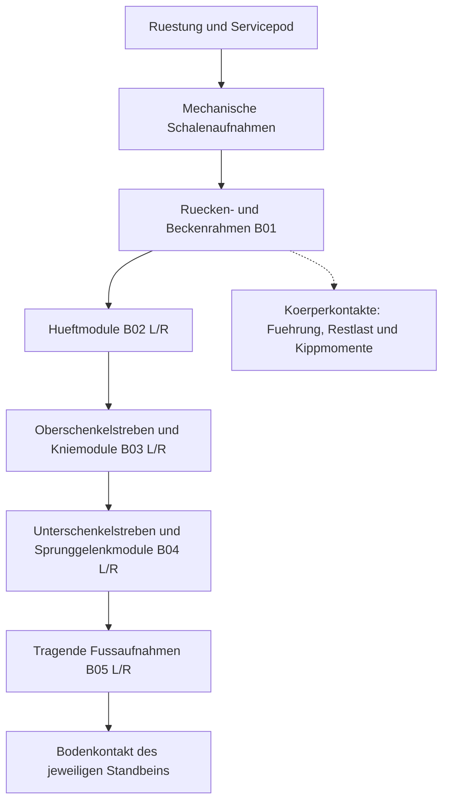

# Exoskelett, Bodenrahmen und eigener Ruestungstraeger

**Zielpraezisierung vom 2026-11-17:** Gewuenscht ist ein Gestell, das
Ruestungsgewicht ueber eine eigene Beinstruktur zum Boden leitet. Dieser
[Bodenrahmen](#3a-neues-entwicklungsziel-ruestungslast-zum-boden)
ist die neue mechanische Entwicklungsrichtung. Der vorhandene Hueft-/Rueckentraeger
und die CAD-Bauraumhuellen leisten diese Funktion noch nicht. Eine motorisierte
Gehhilfe oder automatische Balance ist damit nicht ausgewaehlt.

Das [Projektprofil](Mjolnir-Konfiguration.md) legt fest, ob ein Exoskelett
ueberhaupt zum Aufbau gehoert. Der manuelle Einstieg und der eigene
Ruestungstraeger funktionieren konzeptionell auch ohne aktives Geraet.
Ein Serien-Exoskelett zur Gehunterstuetzung bleibt ein separat auszulegender Ausbau.

## 1. Welche Funktion gebraucht wird

| System | Wirkung | Einsatz im Projekt |
| --- | --- | --- |
| Gepolsterter Ruestungstraeger | Verteilt Ruestungsgewicht zwischen Huefte und Oberkoerper | Grundaufbau, individuell angepasst |
| Aktives Hueft-Exoskelett | Unterstuetzt die Beinbewegung mit eigenen Motoren | Separates Seriengeraet nach Pass- und Integrationsprobe |
| Eigenbau-Beinantrieb E01 (Huefte, spaeter Knie) | Wie oben, aber selbst gebaut nach dem Vorbild Hypershell Halo | [Entwicklungsentwurf](Exoskelett-Eigenbau.md): Steuerlogik und Host-Tests vorhanden, Mechanik und Hardware-Nachweise offen |
| Lasttragender Rahmen mit Beinstruktur und Fussaufnahmen | Soll Ruestungslast zum Boden fuehren | Neues Entwicklungsziel; Kinematik, Detail-CAD und reale Entlastung offen |
| Skeletonics/Pantograph/Stelzen | Vergroessert Reichweite und Silhouette | Keine Basisfunktion; eigener Entwicklungsaufwand und eigener Nachweis |

Ein Wander-Exoskelett traegt nicht automatisch eine schwere Ruestung.
Hypershell schliesst in seinen Safety Guidelines v2.0 Gewichtsabstuetzung,
Balancehilfe und Sturzverhinderung ausdruecklich aus. [Herstellerdokument](https://cdn.shopify.com/s/files/1/0746/6326/4492/files/GL_Hypershell_SafetyGuidelines_v2.0_Printed.pdf?v=1782804835)
Im bisherigen T01-Aufbau bleibt der eigene Traeger fuer Ruestungsgewicht
verantwortlich; der Koerper traegt dieses Gewicht weiterhin. Auch Gurte an den Schultern nehmen
reale Kraefte auf, vor allem beim Kippen. Eine Lastverteilung nur anhand der
Bezeichnung H-Harness oder Klettergurt anzunehmen, ist unzureichend.

## 2. Zwei konkrete aktive Integrationskandidaten

Stand der Quellenpruefung: 2026-09-08. Angaben sind modellspezifisch; keine
Kauf- oder Passformzusage. Aktuelle Originalanleitung beim konkreten Geraet pruefen.

| Kandidat | Verifizierte relevante Angaben | Offene Auswahlpunkte |
| --- | --- | --- |
| Hypershell X Series (S) | Handbuch v1.3: Guertelbereich 72-122 cm, Hueftbreite 31-42 cm, Oberschenkellaenge 36-50 cm; zusaetzliche Groessen-/Gewichtstabelle | Original-Messdefinition, Koerpergewicht, Gurtkonflikt, Motor-/Akkufreiraum |
| DNSYS X1 | Herstellerseite: Taille 70-125 cm, Oberschenkelumfang 40-62 cm; S/M/L nach Taille; aktives Hueftsystem | Gewaehlte Groesse, Hersteller-Passprobe, groesster dynamischer Oberschenkelumfang, Akku-Zugang |

Quellen: [Hypershell Handbuch v1.3, Anhang S.46-47](https://cdn.shopify.com/s/files/1/0746/6326/4492/files/EN_Hypershell_XS_Series_UserManual_v1.3_Media.pdf?v=1788775823),
[DNSYS X1 Produkt und Groessenauswahl](https://dnsys.ai/products/dnsys-x1-exoskeleton-every-step-is-a-leap-forward-carbon-carbon-pro).

Koerpergroesse allein entscheidet keine dieser Passfragen. Das Repository
legt **kein Geraet fuer alle Profile** fest. Passmasse und Koerpergewicht
werden direkt nach Herstellerdefinition erhoben, nicht aus Fotos oder anderen
Massen abgeleitet. Jedes Projekt dokumentiert seine eigene Geraeteauswahl.
Die im CAD optional eingeblendeten roten Volumina sind generische Reserven,
keine vermessenen Hypershell-/DNSYS-Komponenten.

DNSYS beschreibt das X1 als Bewegungshilfe fuer Hueftgelenke mit eigener
Bewegungserkennung. Daraus folgt keine Freigabe fuer einen verkleideten
Cosplay-Einsatz. [DNSYS FAQ](https://dnsys.ai/pages/faq)
Herstellerleistungen wie Reichweite, Watt oder Ermuedungsreduktion werden nicht
in ein angeblich tragbares Ruestungsgewicht umgerechnet.

## 2a. Referenzen fuer einen Lastpfad bis zum Boden

Nachrecherche: 2026-11-17. Die folgende Einordnung ersetzt die bisherige
unzutreffende Empfehlung, Festool EXO 18 als tragenden Ruestungskern zu verwenden.

| Referenz | Belegte Funktion | Bedeutung fuer diesen Aufbau |
| --- | --- | --- |
| [Wandercraft Atalante X](https://www.wandercraft.eu/atalante) | Selbstbalancierendes Rehabilitationssystem mit 12 Motoren | Im verlinkten X-Beitrag benannt; keine passive Vorlage oder Freigabe fuer DIY-Gelenke und eigene Balance-Regelung |
| [Mawashi UPRISE](https://www.mawashi.net/en/uprise) | Passives System mit gelenkiger Lastleitung zum Boden | Passende Funktionsreferenz fuer einen Bodenrahmen; keine uebertragbaren Last-/Passformwerte fuer unseren Entwurf |
| [Mehler Protection ExoM](https://mehler-protection.com/products/exom-exoskeleton/) | Schutzsystem mit integriertem passivem Exoskelett auf UPRISE-Basis | Referenz fuer die Verbindung von Verkleidung und Laststruktur, kein Halo-Bausatz |
| [Festool ExoActive EXO 18](https://www.festool.de/produkte/exoskelett/exoskelett/577339---exo-18-hpc-4,0-i-plus) | Aktive Ueberkopf-Armunterstuetzung, laut Hersteller bis 50 N pro Arm | Kein Bodenrahmen; die frueheren Angaben zu 18 kg Ruestungslast und ca. 500 EUR werden nicht weiterverwendet |

Herstellerangaben zur prozentualen Entlastung werden nicht zum Projektziel
umgerechnet. Die [Studie zu passiver Lastabstuetzung beim Stehen und Gehen](https://pubmed.ncbi.nlm.nih.gov/38703721/)
zeigt, warum beide Lastfaelle getrennt gemessen werden muessen: Die untersuchte
Konfiguration entlastete im Stehen, zeigte beim Gehen aber keine entsprechende
Verringerung der gemessenen Belastung der Person. Auch ein passiver Rahmen
kann Zusatzmasse und Bewegungswiderstand verursachen.

Der erste [X-Beitrag vom 2026-11-09](https://x.com/Ronald_vanLoon/status/2119925518107574551)
bezeichnet das gezeigte System als Atalante X. Diese Zuordnung wurde anhand
der oeffentlichen Beitragsmetadaten geprueft; das Video wurde nicht vollstaendig
analysiert und liefert keine uebernommenen Konstruktionsmasse.

Die zuvor erwaehnte BodyOS-/Ascentiz-Plattform ist fuer diesen Entwurf nicht
als Schnittstelle ausgewaehlt. Konkrete API-, Hardware-, Lizenz- und Lastangaben
sind hier nicht durch gepruefte Originalunterlagen belegt. Sie begruenden
weder eine Anbauentscheidung noch eine Lastabstuetzung.

## 3. Eigener passiver Traeger T01

Zwei einstellbare Rueckenstege verbinden eine breite, gepolsterte Hueftauflage
mit der oberen Torsoaufnahme. Seitliche Querfuehrungen tragen nur Schalen und
deren Oeffnungsmechanik. Schultergurte stabilisieren und teilen je nach
Haltung die Last. Ein schwerer Akku wird nahe dem Ruecken/Hueftbereich auf
dem **eigenen** Traeger montiert, nicht am Motorarm des Seriengeraets.

| Bauteil | Konstruktive Absicht | Fertigungsstatus |
| --- | --- | --- |
| Rueckenstege | Flaches, leichtes Metallprofil mit grossflaechiger Kanten-/Druckpolsterung | Querschnitt nach realem Lastfall festlegen |
| Queraufnahme oben/unten | Zwei getrennte Fuehrungsebenen fuer T02 | Lastdaten und Biegesteifigkeit nachweisen |
| Hueftauflage | Breites textiles Tragesystem mit dokumentierten Anbaupunkten | Passprobe vor Materialkauf |
| Schultergurte | Einstellbar, vorn vollstaendig zu oeffnen | Keine geschlossene Halsschlaufe |
| Schalenhalter | Austauschbare mechanische Montageplatten | Druckteile zuerst nur kosmetisch/als Passlehre |
| Gliedmassenhalter | Separate textile Aufhaenger | Kein starres Gestell ueber menschliche Gelenke |

Eine PSA-/Klettergurt-Zertifizierung ist keine Freigabe fuer selbst gebohrte,
verschraubte oder angenaehte Fremdanbauten. Original-Trageprodukte werden nicht
umgebaut; geeignete Hersteller-Anbaupunkte oder ein separat bemessener
Kostuemtraeger sind erforderlich. Ohne realen Lastfall wird kein Aluquerschnitt
oder Filament als fertig bemessen bezeichnet.

## 3a. Neues Entwicklungsziel: Ruestungslast zum Boden

**Entscheidung vom 2026-11-17:** Der gewuenschte Ausbau soll Ruestungsgewicht
ueber ein Gestell zum Boden ableiten. Als erste zu untersuchende Architektur
wird ein passiver Bodenrahmen vorgesehen. Motoren, Kraftverstaerkung und
Selbstbalance sind keine Voraussetzung dieses Lastpfadkonzepts und keine
bereits implementierte Funktion.

Das Diagramm zeigt den gewuenschten Lastpfad. Es ist kein Nachweis, dass jede
Schale bereits daran angeschlossen ist oder dass alle Lasten am Koerper
vorbeigefuehrt werden. Arm- und Beinschalen bleiben am Koerper getragen, bis
fuer sie eine eigene bewegliche Lastaufnahme entwickelt und geprueft ist.

### Bauraeume und noch zu konstruierende Schnittstellen

Die B-IDs bezeichnen neue Konzeptbaugruppen, keine vorhandenen CAD-Teile.

| ID | Aufgabe | Erforderliche Klaerung vor Detail-CAD |
| --- | --- | --- |
| B01 | Ruecken-/Beckenrahmen nimmt Torso und Akku auf | Teilmassen, Schwerpunkt, Torsion, erreichbare Einstiegsoeffnung und Lastumleitung bei einseitigem Stand |
| B02-L/R | Bewegliche Verbindung vom Becken zu den Beinen | Hueftbeugung, seitliche Bewegung und Rotation; keine auf eine Achse reduzierte Huefte |
| B03-L/R | Oberschenkellastpfad und bewegliche Kniekopplung | Veraenderliche Kniekinematik und notwendiger Ausgleich; kein beliebig platzierter einfacher Scharnierbolzen |
| B04-L/R | Unterschenkellastpfad und bewegliche Knoechelkopplung | Abrollen, seitliche Anpassung und Kollisionsfreiheit; Standbein- und Schwungbeinverhalten |
| B05-L/R | Kraftuebergang vom Rahmen bis zur Laufflaeche | Tatsaechlich tragende Schuh-/Sohlenschnittstelle mit Abrollen, Traktion und werkzeuglosem Ausstieg |

Kosmetische Schuhcover F01 und vorhandene Schuhe bilden allein noch keine
Rahmenabstuetzung. Ob ein geeigneter Schuh in B05 integriert werden kann oder
eine eigene Fusskonstruktion notwendig ist, bleibt offen. Sohlendicke,
Bodenfreiheit und veraenderte Standhoehe werden gemessen; die bisherige Zusage
eines unveraenderten normalen Schuhaufbaus gilt fuer diese Variante nicht.

Gelenkpositionen, Beinlaengen und Bewegungsraeume muessen an der konkreten
Person aufgenommen werden; die 32 vorhandenen Profilmasse reichen dafuer
nicht aus. Ein starrer Rahmen darf keine abweichende Gelenkachse erzwingen.
Ausgleichsfreiheiten und Abstimmung zwischen Stabilitaet und Beweglichkeit
sind eigene Konstruktionsarbeit. Passiv bedeutet nicht automatisch frei
beweglich oder gegen Einknicken und Umkippen gesichert.

### Stehen, Gehen und Einstieg getrennt entwickeln

Beim beidbeinigen Stand kann der Rahmen Last auf zwei Fussaufnahmen verteilen.
Im Schritt muss die angeschlossene Last ueber das jeweilige Standbein
abgestuetzt werden; das Schwungbein hat keinen Bodenkontakt. Wie der passive
Rahmen diese Umverteilung erlaubt, ohne Knie/Huefte zu blockieren oder die
Last wieder auf den Koerper zu geben, ist die zentrale offene Konstruktionsfrage.
Ein im Stehen tragendes Mockup ist daher noch kein gehfaehiges Exoskelett.

Die aufklappenden Schalen und Neodym-Anlegehilfen bleiben als Bedienprinzip
erhalten. Fuer den tragenden Lastpfad sind bemessene mechanische Verbindungen
mit definierter Sicherung erforderlich; die vorhandenen gedruckten Magnethalter
positionieren abnehmbare Dekorteile. Sie tragen weder Rahmenlast noch dienen
sie als Gelenkverriegelung. Lasttragende Trennstellen werden erst entlastet und
dann geoeffnet; ein Panel-Abwurf darf keinen belasteten Rahmen entriegeln.

Der [bisherige Solo-Einstieg](Mjolnir-Selbstanziehen.md) ist eine Vorlage fuer
die Schalen, kein bestandener Anziehversuch mit Bodenrahmen. Rahmen,
Beinaufnahmen und Fussverschluesse brauchen einen eigenen erreichbaren
Einstiegs- und Befreiungsablauf, auch sitzend und ohne Strom.

### Nachweisfolge fuer den ersten Prototyp

1. Massenblatt anlegen: jede Schale, Elektronik, Kabel, Schuhe und Rahmen wiegen;
   Position und Schwerpunkt festhalten. Erwartete Entlastung nicht vorab von
   diesem Gesamtgewicht abziehen.
2. Ungetragenen Lastpfad mit Ersatzmassen pruefen: zunaechst beidseitige, dann
   einseitige Bodenabstuetzung und seitliche Momente. Aufnahmen, Gelenkspiel,
   Verformung und Entlastungsablauf dokumentieren. Querschnitte, Lager und
   Befestigungen nach diesen Lastfaellen fachlich auslegen.
3. Leichten, unbelasteten Kinematik-Prototyp pruefen: Beweglichkeit, Flucht der
   Gelenke, Knieausgleich, Abrollen, Sitzen, Einstieg und vollstaendige Befreiung.
   Keine schweren Ruestungsteile als erste Lastprobe am Menschen verwenden.
4. Erst nach passender Mechanik kleine, dokumentierte Zusatzlasten mit
   unabhaengiger Lastuebernahme und Hilfsperson erproben. Zuerst Stand,
   Gewichtswechsel und einzelne Schritte auf ebener Flaeche; keine Treppen
   aus einem bestandenen Standversuch ableiten.
5. Restlasten an allen Koerperkontakten und Lasten im Rahmen gemeinsam erfassen.
   Eine Waage unter den Fuessen misst auch das Koerpergewicht und kann allein
   keine Entlastung belegen. Gleiche Ruestung ohne Rahmen als Vergleich nutzen,
   das Eigengewicht des Rahmens mitbilanzieren und Stand/Gang separat berichten.

**Aktueller Status:** Architektur und Pruefplan dokumentiert. Individuelle
Kinematik, tragende CAD-Bauteile, Materialdimensionierung, Lastmessungen und
gehfaehiger Hardwareprototyp fehlen noch. Die Option `exoskeleton` im
Projektprofil erzeugt diesen Bodenrahmen nicht.

## 4. Integrationsraum fuer das Seriengeraet

Das aktive Geraet behaelt seine Originalgurte, Manschetten, Elektronik, Akku
und Firmware. Der Ruestungstraeger hat eigene Befestigungspunkte. Eine
mechanische oder elektrische Kraft-/Datenkopplung ist nicht vorgesehen.

1. Seriengeraet ohne Ruestung passend anlegen und reale Bewegungsraeume aufnehmen.
2. Original-Gurtlage und eigenen Huefttraeger gemeinsam pruefen. Ueberlagern
   sich Druckzonen oder rutschen Gurte, ist dieser Traegeraufbau nicht kompatibel.
3. Motoren, bewegte Hebel, Manschetten, Bedienelemente und Akkuentriegelung als
   Freihaltebereiche im eigenen CAD erfassen, inkl. Bewegung und Wartungszugang.
4. Die Ruestungsschale um diese Bereiche aufteilen. Motoren nicht mit einer
   dichten Verkleidung einschliessen; Hersteller-Lueftung und Temperaturgrenzen
   einhalten. Keine Magnete auf oder unmittelbar an Sensor-/Motorgehaeusen.
5. Kabelschlaufen am eigenen Traeger befestigen; bei jeder Bewegung bleiben
   Gurtverschluss und manuelle Abschaltung erreichbar.
6. Stromlose Passprobe, dann vom Hersteller vorgesehene Funktionsprobe;
   anschliessend gemeinsame Probe unter realer Ruestungslast und Temperatur.

Der Freihalteraum wird gemessen, nicht pauschal mit einem festen Abstand von
z.B. 10 mm als sicher erklaert. Aenderungen an Schale, Polsterung oder Gurtlage
koennen eine neue Probe erforderlich machen.

## 5. Integration erst nach Bestehen dieser Nachweise

| Pruefung | Ergebnis derzeit | Abbruchkriterium |
| --- | --- | --- |
| Originalgeraet passt nach Originalanleitung | Offen | Ausserhalb Herstellerbereich / Passform ungeklaert |
| Eigener Traeger passt zusammen mit Geraet | Offen | Druck, Rutschen oder gegenseitiges Verdraengen |
| Volle benoetigte Bewegung ohne Fremdkontakt | Offen | Schale/Gurt/Kabel beruehrt bewegten Hebel oder Sensor |
| Akku und Abschaltung erreichbar | Offen | Ruestung muss dafuer demontiert werden |
| Bedienung nach Herstelleranleitung | Offen | Ruestung verhindert An-/Ablegen oder Bedienung |
| Getrennter mechanischer Notausstieg | Offen | Beide Systeme blockieren sich beim Oeffnen |
| Geraet im stromlosen Zustand beruecksichtigt | Offen | Ausfall erzwingt Bewegung oder verhindert Befreiung |

Die jeweilige Veranstaltung entscheidet ueber ihren konkreten Einsatz. Eine
pauschale Aussage, alle Motoren seien auf allen Conventions verboten oder alle
passiven Federmechaniken erlaubt, wird nicht uebernommen. Fuer die Werkstatt-
und Passphase ist keine Veranstaltungserlaubnis erforderlich.

## 6. Entscheidungsfolge

Fuer den gewaehlten Bodenrahmen gilt zuerst die Nachweisfolge aus Abschnitt 3a.
Der T01-Entwurf bleibt eine separate, am Koerper getragene Variante.
Fuer einen optionalen aktiven Hueftausbau gelten dagegen folgende Schritte:
Zuerst Masse des ausgewaehlten Profils und Torso-Mockup, dann eigener leichter Traeger.
Parallel kann eine Anprobe der beiden Seriengeraete erfolgen. Ergibt die Probe
eine eindeutige Kompatibilitaet, werden die realen Geraetevolumina aufgenommen
und die Schalen angepasst. Ein Geraet passt erst dann zum Projekt, wenn sowohl
sein Originalbetrieb als auch der getrennte Ruestungseinstieg funktionieren.
Das ist ein optionaler aktiver Ausbau, kein als fertig ausgegebenes DIY-Power-Exo.
Der selbst gebaute Antrieb hat eine eigene Nachweisfolge:
[Eigenbau-Beinantrieb E01](Exoskelett-Eigenbau.md).

Systemzusammenhang: [MJOLNIR-Systementwurf](Mjolnir-Systementwurf.md).
